# BÁO CÁO TIỂU LUẬN / BÀI TẬP LỚN
## ĐỀ TÀI: XÂY DỰNG RESTFUL API CHO HỆ THỐNG QUẢN LÝ SỬ DỤNG NODEJS, EXPRESSJS VÀ MONGODB

---

## CHƯƠNG 1: LỜI MỞ ĐẦU & YÊU CẦU ĐỀ TÀI

### 1.1. Lý do chọn đề tài
Trong thời đại chuyển đổi số hiện nay, các ứng dụng dịch vụ ăn uống và mua sắm trực tuyến (F&B) ngày càng phát triển mạnh mẽ. Để vận hành trơn tru, hệ thống đòi hỏi một kiến trúc backend hiệu năng cao, linh hoạt và ổn định. Đề tài tập trung vào nghiên cứu và xây dựng hệ thống RESTful API quản lý cửa hàng ăn uống sử dụng công nghệ phổ biến hiện nay: **Node.js, ExpressJS và MongoDB**. Bên cạnh đó, tiểu luận giải quyết bài toán thực tế tích hợp dịch vụ định vị địa lý bên ngoài giúp tự động hóa việc xác định vị trí của chi nhánh và địa chỉ giao hàng của khách hàng, đồng thời tích hợp tính năng theo dõi lộ trình di chuyển thực tế của shipper thông qua GPS thiết bị và vẽ đường đi trên bản đồ.

### 1.2. Mô tả bài toán & Yêu cầu chức năng
Hệ thống RESTful API cần đáp ứng các nghiệp vụ quản trị và mua hàng cốt lõi bao gồm:
- **Quản lý danh mục & sản phẩm thực đơn (CRUD)**: Cho phép xem danh sách, xem chi tiết, tạo mới, chỉnh sửa thông tin và xóa sản phẩm/danh mục.
- **Xác thực người dùng (Authentication)**: Đăng ký tài khoản, đăng nhập cấp quyền bằng JSON Web Token (JWT) kết hợp phân quyền theo vai trò (Admin, Customer, Shipper).
- **Quản lý giỏ hàng & Đơn hàng**: Khách hàng có thể thêm món ăn vào giỏ hàng, áp dụng mã giảm giá (Coupon), sử dụng điểm thành viên và tiến hành đặt hàng.
- **Tích hợp API định vị ngoài (Nominatim Geocoding)**: Khi người dùng thêm địa điểm chi nhánh mới bằng cách nhập địa chỉ văn bản thường, hệ thống tự động gọi API định vị bên ngoài để phân tích cú pháp địa chỉ và điền tọa độ địa lý (Vĩ độ - Latitude, Kinh độ - Longitude) vào cơ sở dữ liệu.
- **Theo dõi shipper di chuyển thời gian thực**: Shipper bật trạng thái Online và nhận giao đơn. Hệ thống liên tục thu thập vị trí GPS từ thiết bị di động của shipper và phát tín hiệu thời gian thực (WebSockets) để khách hàng và hệ thống vẽ lộ trình chỉ đường đi từ shipper đến đơn hàng.
- **Bình luận & Đánh giá (Review & Rating)**: Sau khi đơn hàng được giao thành công (status = DELIVERED), khách hàng có quyền gửi đánh giá số sao (1-5★) kèm bình luận bằng chữ cho từng sản phẩm trong hóa đơn. Điểm đánh giá trung bình sẽ được cập nhật động và hiển thị ở trang sản phẩm.
- **Bảo mật và nhật ký**: Triển khai các middleware tự viết bao gồm ghi nhận log request, kiểm tra tính hợp lệ của dữ liệu đầu vào (Validation body), phân quyền, và xử lý lỗi tập trung.

---

## CHƯƠNG 2: CƠ SỞ LÝ THUYẾT & KIẾN TRÚC HỆ THỐNG

### 2.1. NodeJS và ExpressJS
- **Node.js**: Là môi trường chạy JavaScript phía máy chủ sử dụng mô hình I/O phi tuần tự (Non-blocking I/O) và hướng sự kiện (Event-driven), giúp tối ưu hiệu năng cho các ứng dụng có số lượng kết nối đồng thời lớn.
- **ExpressJS**: Là framework tối giản, linh hoạt của Node.js, cung cấp bộ tính năng mạnh mẽ để xây dựng các ứng dụng web và API di động. ExpressJS hỗ trợ quản lý định tuyến (routing) và triển khai các middleware theo mô hình đường ống (pipeline) xử lý yêu cầu/phản hồi cực kỳ hiệu quả.

### 2.2. MongoDB và Mongoose ODM
- **MongoDB**: Là cơ sở dữ liệu phi quan hệ hướng tài liệu (NoSQL Document Store), lưu trữ dữ liệu dưới định dạng giống JSON gọi là BSON. Nó cho phép thay đổi cấu trúc dữ liệu linh hoạt, không yêu cầu thiết lập ràng buộc khóa ngoại cứng nhắc như SQL, tăng tốc độ đọc ghi.
- **Mongoose**: Là thư viện mô hình hóa tài liệu đối tượng (ODM) cho MongoDB trong Node.js. Mongoose cung cấp giải pháp dựa trên schema để lập mô hình dữ liệu ứng dụng, tự động xác thực trường thông tin và kiểu dữ liệu.

### 2.3. Dịch vụ định vị địa lý OpenStreetMap Nominatim
- **Nominatim**: Là công cụ tìm kiếm dữ liệu OpenStreetMap theo tên và địa chỉ (Geocoding) cũng như tìm địa chỉ từ tọa độ (Reverse Geocoding). Nominatim cung cấp API miễn phí công khai, trả kết quả định dạng JSON chuẩn hóa chứa đầy đủ vĩ độ (`lat`) và kinh độ (`lon`), giúp hệ thống thực hiện định vị địa lý mà không phụ thuộc vào các dịch vụ trả phí.

---

## CHƯƠNG 3: THIẾT KẾ HỆ THỐNG & CƠ SỞ DỮ LIỆU

### 3.1. Sơ đồ Use Case tổng quát (PlantUML)
Sơ đồ mô tả các tác nhân (Actors) bao gồm Khách hàng (Customer), Shipper, Quản trị viên (Admin) tương tác với các chức năng chính của hệ thống.

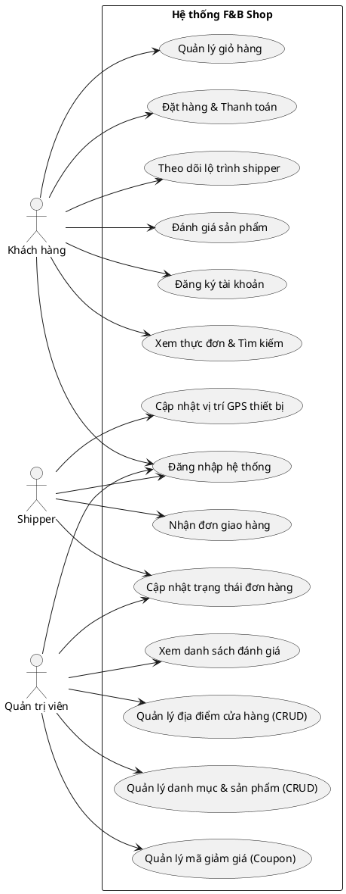

### 3.2. Đặc tả chi tiết các Use Case chính

#### 3.2.1. Đặc tả Use Case 1: Đăng ký tài khoản
- **Tác nhân chính**: Khách hàng.
- **Mô tả ngắn gọn**: Cho phép người dùng tạo tài khoản mới trên hệ thống để thực hiện đặt hàng.
- **Tiền điều kiện**: Email và số điện thoại đăng ký chưa từng tồn tại trên hệ thống.
- **Luồng sự kiện chính**:
  1. Người dùng truy cập trang Đăng ký, nhập họ tên, email, số điện thoại và mật khẩu.
  2. Người dùng nhấn nút "Đăng ký".
  3. Hệ thống kiểm tra tính hợp lệ của dữ liệu nhập vào (không trống, email đúng định dạng, mật khẩu đủ độ dài).
  4. Hệ thống truy vấn DB kiểm tra xem email hoặc số điện thoại đã tồn tại chưa.
  5. Hệ thống mã hóa mật khẩu bằng thuật toán bcryptjs.
  6. Hệ thống tạo bản ghi người dùng mới với vai trò mặc định là `CUSTOMER`.
  7. Hệ thống thông báo đăng ký thành công.
- **Luồng ngoại lệ**:
  - *Email hoặc số điện thoại đã tồn tại*: Hệ thống dừng xử lý và phản hồi lỗi 400 Bad Request kèm thông báo tài khoản đã tồn tại.
- **Hậu điều kiện**: Tài khoản mới được ghi nhận trong cơ sở dữ liệu MongoDB và người dùng có thể đăng nhập.

#### 3.2.2. Đặc tả Use Case 2: Đăng nhập hệ thống
- **Tác nhân chính**: Khách hàng, Shipper, Quản trị viên.
- **Mô tả ngắn gọn**: Xác thực tài khoản người dùng và cấp mã JWT để truy cập các tài nguyên bảo mật.
- **Tiền điều kiện**: Tài khoản đã được đăng ký và đang ở trạng thái hoạt động (`isActive: true`).
- **Luồng sự kiện chính**:
  1. Người dùng nhập email và mật khẩu tại trang Đăng nhập và nhấn nút "Đăng nhập".
  2. Hệ thống tìm kiếm người dùng trong cơ sở dữ liệu dựa trên email.
  3. Hệ thống so khớp mật khẩu đã nhập với chuỗi hash mật khẩu trong cơ sở dữ liệu.
  4. Hệ thống tạo mã Access Token bằng JWT có thời hạn và chứa thông tin định danh (id, role).
  5. Hệ thống trả về thông tin người dùng và JWT Access Token.
- **Luồng ngoại lệ**:
  - *Tài khoản không tồn tại hoặc sai mật khẩu*: Hệ thống phản hồi lỗi 401 Unauthorized kèm thông báo thông tin đăng nhập không chính xác.
- **Hậu điều kiện**: Người dùng đăng nhập thành công và lưu trữ JWT token trên Client để sử dụng cho các yêu cầu API tiếp theo.

#### 3.2.3. Đặc tả Use Case 3: Xem thực đơn & Tìm kiếm sản phẩm
- **Tác nhân chính**: Khách hàng.
- **Mô tả ngắn gọn**: Khách hàng xem danh mục món ăn, danh sách sản phẩm, lọc theo khoảng giá hoặc tìm kiếm theo từ khóa.
- **Tiền điều kiện**: Các sản phẩm đang ở trạng thái còn hàng (`isAvailable: true`).
- **Luồng sự kiện chính**:
  1. Khách hàng truy cập trang thực đơn.
  2. Hệ thống tải danh sách sản phẩm theo bộ lọc mặc định.
  3. Khách hàng có thể nhập từ khóa vào ô tìm kiếm hoặc chọn lọc theo danh mục hoặc khoảng giá.
  4. Hệ thống thực hiện tìm kiếm regex không phân biệt chữ hoa/thường trên trường tên và mô tả sản phẩm.
  5. Hệ thống trả về danh sách sản phẩm khớp bộ lọc kèm theo thông tin phân trang (trang hiện tại, tổng số trang).
- **Hậu điều kiện**: Khách hàng xem được các sản phẩm phù hợp trên giao diện.

#### 3.2.4. Đặc tả Use Case 4: Đặt hàng & Thanh toán
- **Tác nhân chính**: Khách hàng.
- **Mô tả ngắn gọn**: Khách hàng xác nhận giỏ hàng, áp dụng khuyến mãi, định vị địa lý và tạo đơn hàng mới.
- **Tiền điều kiện**: Khách hàng đã đăng nhập, giỏ hàng có tối thiểu 1 sản phẩm.
- **Luồng sự kiện chính**:
  1. Khách hàng nhấn đặt hàng từ giỏ hàng.
  2. Hệ thống kiểm tra tính khả dụng của từng món ăn trong giỏ hàng.
  3. Hệ thống áp dụng mã giảm giá và tính toán số điểm tích lũy sử dụng (nếu có).
  4. Hệ thống gọi API Nominatim Geocoding bên ngoài để phân tích địa chỉ của khách hàng thành tọa độ địa lý thực tế.
  5. Khách hàng chọn phương thức thanh toán (COD hoặc VietQR qua SePay).
  6. Hệ thống tạo đơn hàng mới với mã đơn ngẫu nhiên và trạng thái ban đầu tương ứng.
- **Hậu điều kiện**: Đơn hàng được lưu trữ thành công, giỏ hàng được làm rỗng và điểm tích lũy được khấu trừ.

#### 3.2.5. Đặc tả Use Case 5: Thanh toán tự động (SePay Webhook)
- **Tác nhân chính**: Hệ thống ngân hàng/SePay.
- **Mô tả ngắn gọn**: Tự động xác nhận thanh toán cho các hóa đơn chuyển khoản qua VietQR.
- **Tiền điều kiện**: Khách hàng đã đặt đơn hàng ở trạng thái `PENDING_PAYMENT` chọn thanh toán qua VietQR.
- **Luồng sự kiện chính**:
  1. Khách hàng thực hiện quét mã QR ngân hàng và chuyển khoản đúng số tiền kèm nội dung là mã đơn hàng.
  2. Cổng thanh toán SePay nhận được giao dịch chuyển khoản thành công và gọi Webhook gửi yêu cầu HTTP POST tới backend.
  3. Backend xác thực mã bảo mật `Apikey` trong Header của yêu cầu.
  4. Backend quét tìm mã hóa đơn dạng `DHxxxx` trong nội dung chuyển khoản.
  5. Backend tìm đơn hàng tương ứng, kiểm tra số tiền chuyển khoản khớp tổng tiền đơn hàng.
  6. Backend cập nhật đơn hàng thành `paymentStatus: 'PAID'` và `status: 'CONFIRMED'`.
  7. Backend gửi thông báo thời gian thực qua Socket.IO tới màn hình khách hàng để tự cập nhật trạng thái đã thanh toán.
- **Hậu điều kiện**: Trạng thái thanh toán của đơn hàng được cập nhật thành đã thanh toán tự động.

#### 3.2.6. Đặc tả Use Case 6: Shipper nhận đơn giao (Claim Order)
- **Tác nhân chính**: Shipper.
- **Mô tả ngắn gọn**: Shipper nhận vận chuyển đơn hàng đang sẵn sàng giao.
- **Tiền điều kiện**: Shipper đang Online và đơn hàng có trạng thái `READY` (chưa có shipper nào nhận).
- **Luồng sự kiện chính**:
  1. Shipper xem danh sách các đơn hàng chờ giao.
  2. Shipper bấm nút "Nhận giao đơn này".
  3. Hệ thống kiểm tra xem đơn hàng đã bị shipper khác nhận trước đó hay chưa.
  4. Hệ thống gán `shipperId` của đơn hàng bằng id của Shipper hiện tại và cập nhật trạng thái đơn hàng sang `DELIVERING`.
  5. Hệ thống ghi nhận log trạng thái và gửi thông báo Socket.IO cho khách hàng biết đơn hàng bắt đầu được đi giao.
- **Hậu điều kiện**: Đơn hàng được bàn giao cho Shipper chịu trách nhiệm giao hàng.

#### 3.2.7. Đặc tả Use Case 7: Cập nhật định vị thiết bị Shipper thực tế (Live Tracking)
- **Tác nhân chính**: Shipper.
- **Mô tả ngắn gọn**: Tự động phát tọa độ GPS phần cứng của thiết bị shipper lên server theo thời gian thực.
- **Tiền điều kiện**: Shipper đang đi giao đơn hàng (`status: 'DELIVERING'`).
- **Luồng sự kiện chính**:
  1. Trình duyệt của Shipper gọi `navigator.geolocation.watchPosition` để theo dõi GPS của thiết bị.
  2. Khi shipper di chuyển, tọa độ mới được bắt và cập nhật vào state `shipperLocation`.
  3. Giao diện shipper gửi sự kiện WebSockets `shipperLocationUpdate` chứa tọa độ thực tế lên Server.
  4. Server WebSockets phát tiếp sự kiện `shipperLocationChanged` cho khách hàng nằm trong phòng đơn hàng theo dõi.
  5. Khách hàng nhận được tọa độ mới, cập nhật Marker và vẽ lại lộ trình chỉ đường đi mà không bị reload Iframe.
- **Hậu điều kiện**: Tọa độ GPS của thiết bị shipper được cập nhật liên tục thời gian thực.

#### 3.2.8. Đặc tả Use Case 8: Khách hàng đánh giá món ăn
- **Tác nhân chính**: Khách hàng.
- **Mô tả ngắn gọn**: Khách hàng viết bình luận và chấm số sao cho món ăn đã giao thành công.
- **Tiền điều kiện**: Đơn hàng ở trạng thái `DELIVERED` và khách hàng chưa từng đánh giá sản phẩm đó trong đơn hàng này.
- **Luồng sự kiện chính**:
  1. Khách hàng truy cập trang chi tiết đơn hàng đã giao, chọn món ăn trong đơn để đánh giá.
  2. Khách hàng chọn số sao (1-5★), nhập bình luận bằng chữ và bấm gửi.
  3. Hệ thống xác nhận đơn hàng thuộc quyền sở hữu của khách hàng và đã hoàn thành.
  4. Hệ thống kiểm tra ràng buộc unique index để đảm bảo không bị đánh giá trùng lặp.
  5. Hệ thống tạo bản ghi đánh giá mới lưu vào cơ sở dữ liệu.
- **Hậu điều kiện**: Đánh giá được ghi nhận và hiển thị công khai ở trang chi tiết sản phẩm.

#### 3.2.9. Đặc tả Use Case 9: Quản lý địa điểm cửa hàng (Admin CRUD)
- **Tác nhân chính**: Quản trị viên (Admin).
- **Mô tả ngắn gọn**: Admin thêm chi nhánh cửa hàng mới và hệ thống tự động định vị địa lý.
- **Tiền điều kiện**: Admin đã đăng nhập với vai trò quản trị viên.
- **Luồng sự kiện chính**:
  1. Admin truy cập Dashboard quản lý chi nhánh, chọn thêm mới, điền tên chi nhánh và địa chỉ dạng văn bản.
  2. Hệ thống gọi API Nominatim Geocoding ngoài để xác định vĩ độ và kinh độ của chi nhánh đó.
  3. Hệ thống lưu chi nhánh mới vào DB kèm tọa độ địa lý đã phân tích được.
  4. Chi nhánh mới hiển thị trên danh sách quản trị.
- **Hậu điều kiện**: Địa điểm chi nhánh được thêm mới vào cơ sở dữ liệu với đầy đủ thông tin tọa độ.

---

### 3.3. Sơ đồ lớp (Class Diagram - PlantUML)
Sơ đồ lớp mô tả cấu trúc các thực thể Mongoose model và mối quan hệ liên kết giữa chúng. Trong đó thực thể **Location** (Địa điểm chi nhánh cửa hàng) được liên kết chặt chẽ với:
- **Order (Đơn hàng)**: Mỗi đơn hàng được chuẩn bị và xuất phát từ một Chi nhánh cửa hàng (`Location`) cụ thể để giao cho khách hàng (Quan hệ 1 chi nhánh chuẩn bị nhiều đơn hàng).
- **User (Người dùng)**: Cả quản trị viên (Admin) và người giao hàng (Shipper) đều được phân công làm việc hoặc trực thuộc quản lý tại một Chi nhánh cửa hàng (`Location`) nhất định (Quan hệ 1 chi nhánh quản lý nhiều người dùng).

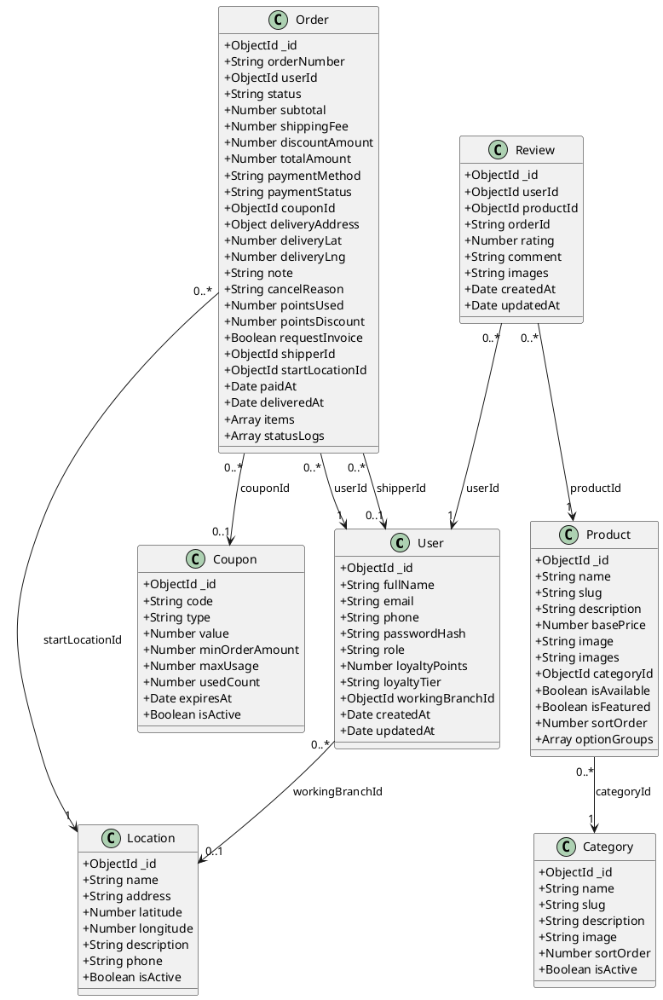

### 3.4. Sơ đồ tuần tự các chức năng chính (Sequence Diagrams - PlantUML)
Dưới đây là sơ đồ tuần tự biểu diễn chi tiết từng chức năng độc lập của hệ thống.

#### 3.4.1. Đăng ký tài khoản (Register)
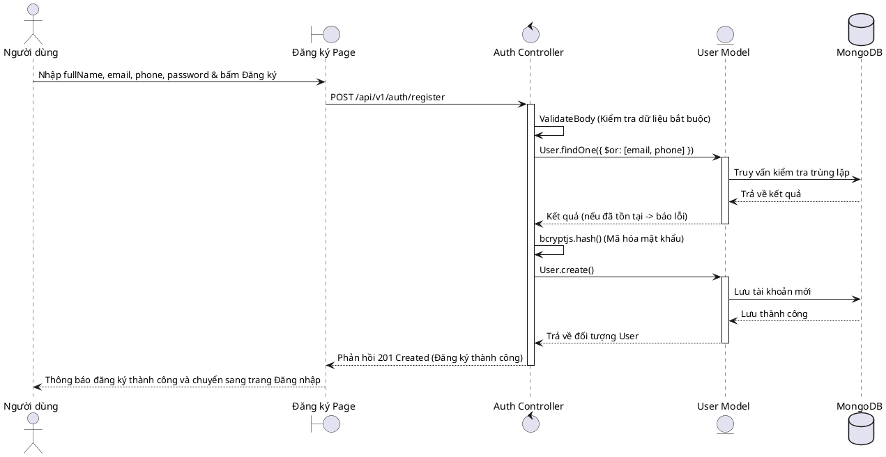

#### 3.4.2. Đăng nhập hệ thống (Login)
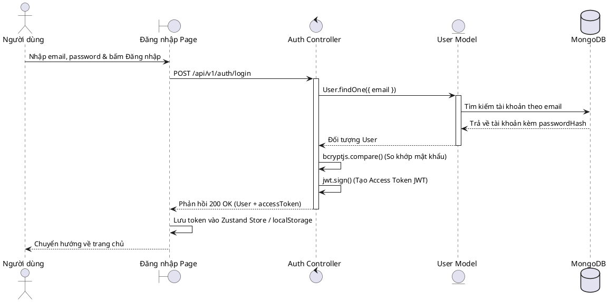

#### 3.4.3. Xem thực đơn và Tìm kiếm sản phẩm (View & Search Menu)
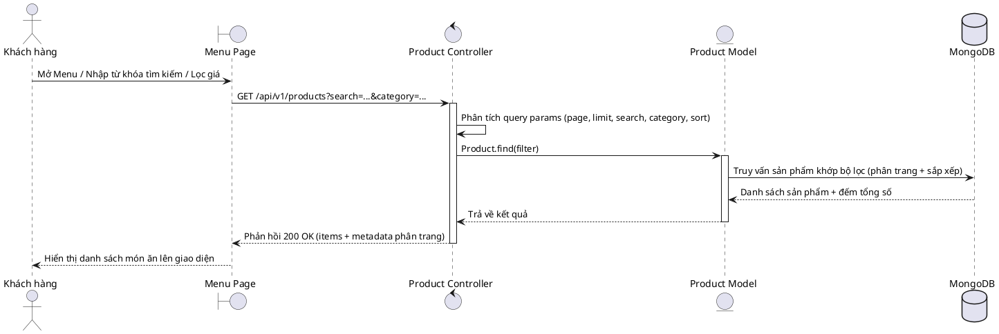

#### 3.4.4. Quy trình Đặt hàng (Checkout)
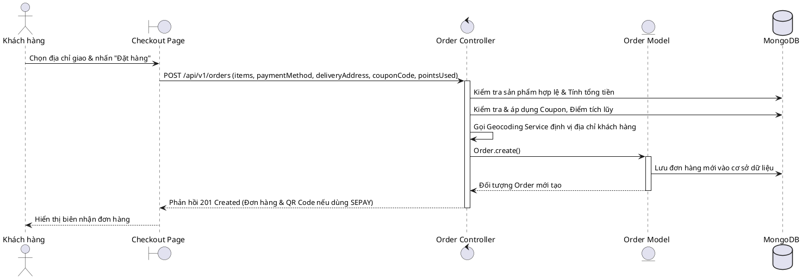

#### 3.4.5. Xác thực thanh toán ngân hàng tự động (SePay Webhook)
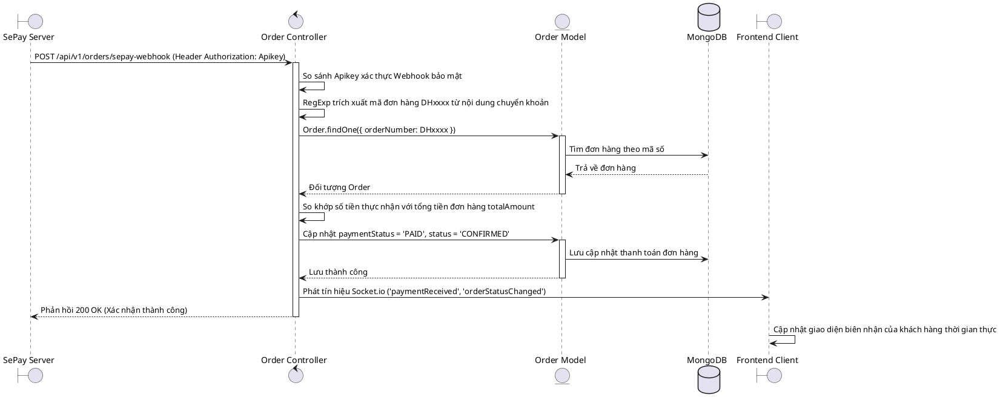

#### 3.4.6. Shipper nhận đơn giao hàng (Claim Order)
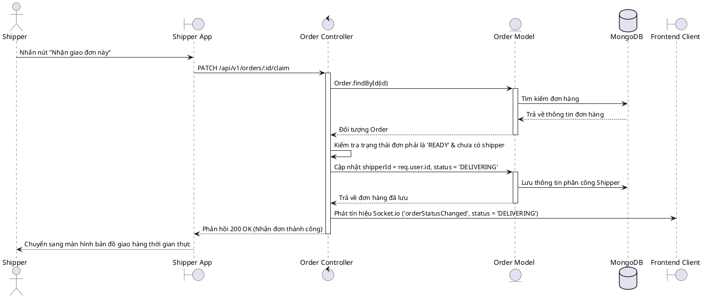

#### 3.4.7. Định vị shipper giao hàng thời gian thực (Live Geolocation Update)
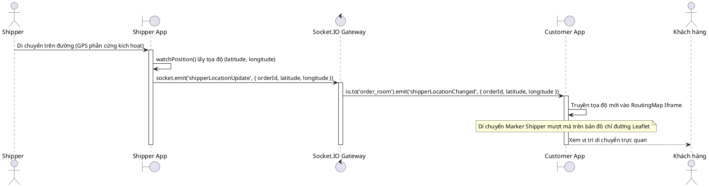

#### 3.4.8. Gửi đánh giá sản phẩm (Create Review)
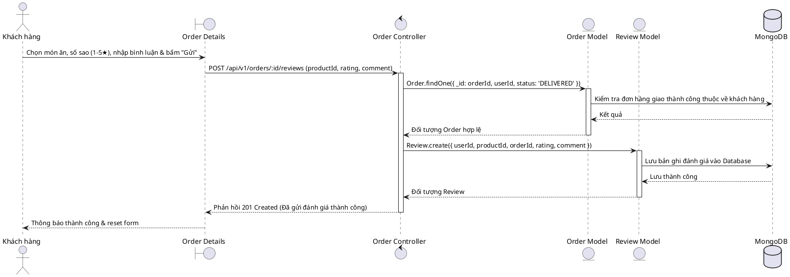

#### 3.4.9. Admin thêm chi nhánh cửa hàng mới (Admin CRUD Location)
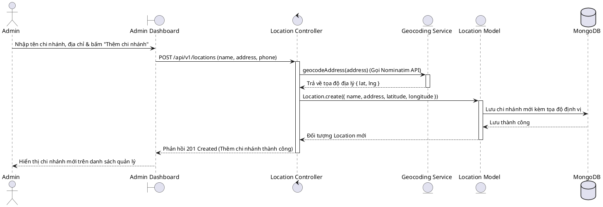

### 3.5. Sơ đồ thực thể liên kết cơ sở dữ liệu (ERD Database - PlantUML)
Sơ đồ ERD thể hiện chi tiết liên kết giữa các bảng cơ sở dữ liệu MongoDB. Tại đây, thực thể **locations** (Địa điểm chi nhánh cửa hàng) được liên kết quan hệ 1-n:
- Liên kết với **orders** qua thuộc tính `startLocationId` để xác định chi nhánh nào chuẩn bị đơn hàng và là điểm xuất phát chỉ đường giao hàng.
- Liên kết với **users** qua thuộc tính `workingBranchId` xác định chi nhánh làm việc trực thuộc của nhân viên/shipper/admin.

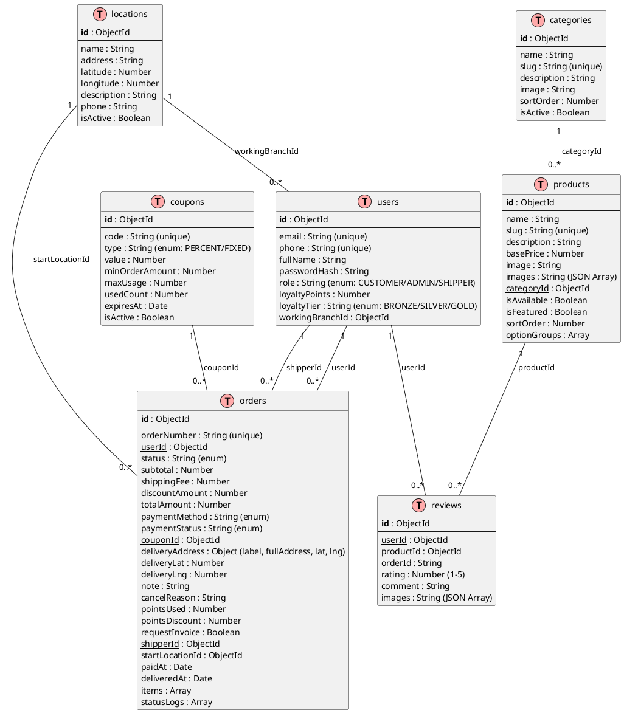

---

## CHƯƠNG 4: HIỆN THỰC HÓA CÁC CHỨC NĂNG CỐT LÕI (BACKEND)

### 4.1. Phân tích chi tiết từng thành phần Backend đã thực hiện

#### 4.1.1. Tầng Model (Schemas)
Khai báo đầy đủ các mối liên kết khóa ngoại bằng `mongoose.Schema.Types.ObjectId` cùng thuộc tính `ref` giúp liên kết các Collection với nhau. Tận dụng cơ chế `set('toJSON')` để tự động biến đổi định dạng dữ liệu thô từ MongoDB (như biến đổi `_id` thành `id` kiểu String, lọc bỏ `_v`) trước khi trả về Client.
- **Review Model**: Chứa các trường liên kết người dùng, sản phẩm, mã đơn hàng để quản lý bình luận. Thiết lập chỉ mục phức hợp unique index `{ userId: 1, orderId: 1, productId: 1 }` để ràng buộc một khách hàng chỉ được phép đánh giá một sản phẩm cụ thể trong một đơn hàng một lần duy nhất.
- **Order Model**: Lưu trữ mảng `items` gồm danh sách món ăn, số lượng và các tùy chọn size/topping. Định nghĩa trường `statusLogs` để ghi lại lược sử thay đổi trạng thái kèm thời gian cụ thể.

#### 4.1.2. Tầng Controller & Logic nghiệp vụ
- **Order Controller (`order.controller.js`)**:
  - `createOrder`: Phục vụ nghiệp vụ đặt hàng phức tạp. Tính toán giá tiền sản phẩm, cộng tiền các tùy chọn extra, áp dụng mã giảm giá `Coupon`, kiểm tra tính khả dụng của mã, kiểm tra và trừ điểm tích lũy thành viên, gọi API Geocoding để gán tọa độ vĩ độ/kinh độ giao hàng, sau đó dọn sạch giỏ hàng.
  - `getOrderById`: Đã được nâng cấp để populate thông tin người dùng (`userId`), thông tin shipper (`shipperId`) và thông tin chi tiết sản phẩm (`items.productId`). Giúp Client hiển thị hình ảnh sản phẩm trong trang biên nhận đơn hàng.
  - `createReview`: Xác nhận khách hàng sở hữu đơn hàng và trạng thái đơn phải là `DELIVERED` mới được phép ghi nhận đánh giá vào DB.
- **Product Controller (`product.controller.js`)**:
  - `getProductReviews`: API phục vụ lấy danh sách bình luận của sản phẩm, thực hiện populate trường `userId` nhằm hiển thị tên người đánh giá.
  - `findAll`: Hỗ trợ đầy đủ phân trang, lọc theo danh mục, lọc theo mức giá tối thiểu/tối đa, tìm kiếm mờ bằng regex theo tên hoặc mô tả, sắp xếp theo giá tăng/giảm dần hoặc mới nhất.

#### 4.1.3. Tầng Router (Định tuyến chuẩn RESTful)
Định nghĩa hệ thống định tuyến tường minh, phân tách nhiệm vụ rõ ràng:
- `/api/v1/auth`: Đăng ký, đăng nhập, lấy thông tin cá nhân.
- `/api/v1/products`: Tuyến công khai xem sản phẩm và tuyến Admin quản lý (CRUD).
- `/api/v1/orders`: Đặt hàng, theo dõi đơn, shipper nhận đơn, webhook tự động.

#### 4.1.4. Tầng Middleware
Hệ thống sử dụng các middleware tự viết để kiểm soát tính toàn vẹn:
1. **Logger Middleware (`logger.js`)**: Tính toán thời gian đáp ứng của server cho từng request bằng cách ghi nhận thời điểm bắt đầu và in ra kết quả.
2. **Validation Middleware (`validation.js`)**: Middleware lọc dữ liệu đầu vào. Nhận vào danh sách các trường bắt buộc, duyệt qua `req.body` và chặn ngay lập tức nếu thiếu thông tin, trả về mã lỗi 400 rõ ràng.
3. **Auth Middleware (`auth.js`)**:
   - `requireAuth`: Giải mã Access Token dạng JWT được gửi lên từ Header `Authorization: Bearer <token>`, tìm kiếm tài khoản trong DB để gán vào `req.user`.
   - `restrictTo`: Phân quyền dựa trên phân loại vai trò (`ADMIN`, `CUSTOMER`, `SHIPPER`).

#### 4.1.5. Tầng Service (Định vị Geocoding Nominatim)
Tách biệt xử lý tích hợp bên ngoài thành service [geocoding.js](file:///d:/project_drink_and_food_shop/backend/src/services/geocoding.js). Sử dụng thư viện `axios` để giao tiếp với OpenStreetMap Nominatim. Đảm bảo cấu hình đúng tiêu đề `User-Agent` của hệ thống để Nominatim chấp thuận yêu cầu không bị chặn. Tự động chuyển đổi phản hồi từ dạng chữ sang tọa độ số thực lưu trữ trực tiếp vào DB của đơn hàng và chi nhánh địa điểm.

#### 4.1.6. Cổng tương tác thời gian thực WebSockets (Socket.IO)
Thiết lập tại [main.js](file:///d:/project_drink_and_food_shop/backend/src/main.js). Lắng nghe thiết bị tham gia vào các phòng theo dõi đơn hàng (`joinOrderRoom`). Lắng nghe sự kiện di chuyển vị trí thực tế của thiết bị shipper phát lên (`shipperLocationUpdate`) để chuyển tiếp thời gian thực (`shipperLocationChanged`) tới khách hàng đang mở trang theo dõi tương ứng.

#### 4.1.7. Hệ thống điểm tích lũy thành viên (Loyalty System)
Hệ thống cài đặt chức năng điểm thưởng động trong quá trình cập nhật trạng thái đơn hàng sang `DELIVERED`:
- Quy đổi chi tiêu: Mỗi 10.000 VNĐ thanh toán thực tế sẽ tích lũy thành 1 điểm thành viên.
- Thăng hạng thành viên: Tự động nâng hạng khi đạt các cột mốc: đồng (Bronze - dưới 100 điểm), bạc (Silver - từ 100 đến 299 điểm), vàng (Gold - từ 300 điểm trở lên).
- Tiêu điểm thành viên: Khi đặt hàng, khách hàng có thể nhập số điểm muốn sử dụng, hệ thống đối chiếu số dư điểm, quy đổi tỉ lệ 1 điểm = 1.000 VNĐ để trực tiếp giảm trừ vào hóa đơn thanh toán.

---

## CHƯƠNG 5: KẾT QUẢ KIỂM THỬ API & ĐÁNH GIÁ

### 5.1. Dữ liệu mẫu (Seed Data)
Hệ thống đã được nạp dữ liệu mẫu thành công qua lệnh `npm run seed`. Đảm bảo trong cơ sở dữ liệu MongoDB có đầy đủ tối thiểu 5 bản ghi cho các bảng chính nhằm phục vụ hiển thị frontend NextJS và chạy kiểm thử API.

### 5.2. Kết quả kiểm thử bằng hình ảnh (Postman/Thunder Client)
*(Sinh viên tiến hành import tệp tin `test_api.json` vào Postman, thực hiện gửi các Request và chụp ảnh kết quả dán vào các phần tương ứng dưới đây)*

#### 5.2.1. Đăng nhập hệ thống (Lấy Access Token)
- **Mô tả**: Gửi thông tin email/mật khẩu tới `POST /api/v1/auth/login`.
- **Kết quả trả về**: Token xác thực JWT dạng JSON.
- *(Dán ảnh chụp Postman tại đây)*

#### 5.2.2. Thêm mới Địa điểm (Xác thực Geocoding hoạt động)
- **Mô tả**: Gửi yêu cầu `POST /api/v1/locations` chỉ truyền trường `name` và `address` ("700 Nguyễn Văn Linh, Tân Phong, Quận 7, Hồ Chí Minh") mà không truyền tọa độ.
- **Kết quả trả về**: Server tự động phân tích và phản hồi JSON chứa đối tượng địa điểm đã bổ sung `latitude: 10.7626` và `longitude: 106.6601` một cách chính xác.
- *(Dán ảnh chụp Postman tại đây)*

#### 5.2.3. Xem danh sách Sản phẩm (CRUD Read)
- **Mô tả**: Thực hiện truy vấn `GET /api/v1/products?search=trà sữa`.
- **Kết quả trả về**: Danh sách món ăn khớp từ khóa kèm thông tin danh mục bóc tách liên quan dạng JSON.
- *(Dán ảnh chụp Postman tại đây)*

#### 5.2.4. Tạo đơn hàng và lấy mã QR VietQR (Checkout)
- **Mô tả**: Thực hiện `POST /api/v1/orders` thanh toán qua tài khoản SePay ngân hàng.
- **Kết quả trả về**: Hóa đơn đặt hàng kèm thông tin QR thanh toán tự động VietQR liên kết đúng số tiền hóa đơn.
- *(Dán ảnh chụp Postman tại đây)*

#### 5.2.5. Truy cập tài liệu API tự động qua Swagger UI
- **Mô tả**: Truy cập `http://localhost:4000/api-docs` bằng trình duyệt web.
- **Kết quả**: Giao diện Swagger UI hiển thị trực quan toàn bộ các nhóm API và hỗ trợ test trực tiếp trên Web.
- *(Dán ảnh chụp giao diện tại đây)*

---

## KẾT LUẬN & HƯỚNG PHÁT TRIỂN
Ứng dụng đã giải quyết trọn vẹn yêu cầu của đề tài mở đề xuất: chuyển đổi thành công kiến trúc backend sang ExpressJS thuần túy với cấu trúc MVC rõ ràng. Hệ thống xử lý lỗi tập trung tốt, mã nguồn được bổ sung chú thích rõ ràng bằng Tiếng Việt, tích hợp thành công dịch vụ định vị ngoài Nominatim, định vị thiết bị GPS thực tế của shipper thời gian thực, cơ chế thanh toán VietQR tự động và tài liệu hóa chuẩn REST API bằng Swagger UI trực quan.

**Hướng phát triển**:
- Tích hợp thêm các giải pháp lưu trữ Cache (Redis) để giảm số lượng cuộc gọi trùng lặp tới Nominatim API nhằm tránh bị giới hạn băng thông (Rate-limit).
- Nâng cấp bảo mật SSL và cơ chế xác thực đa nhân tố cho tài khoản người dùng và shipper.
